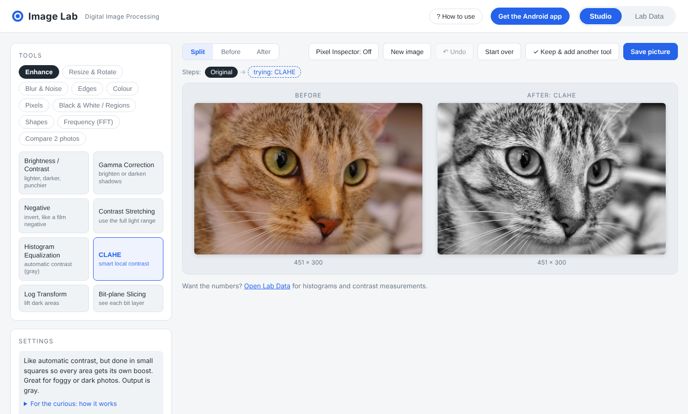
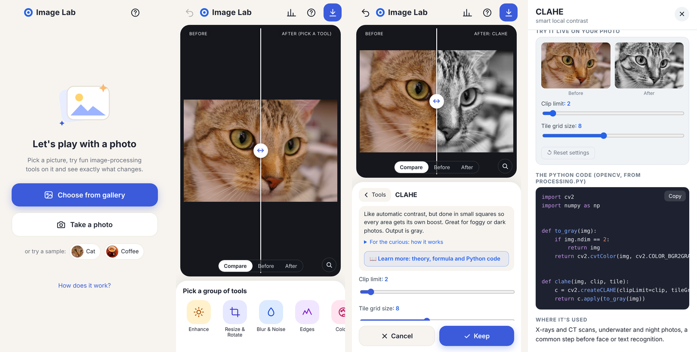
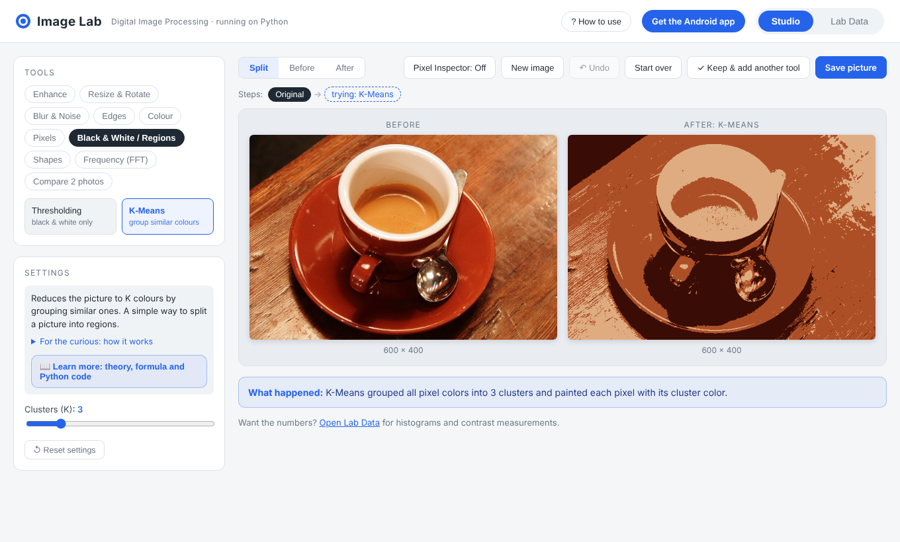
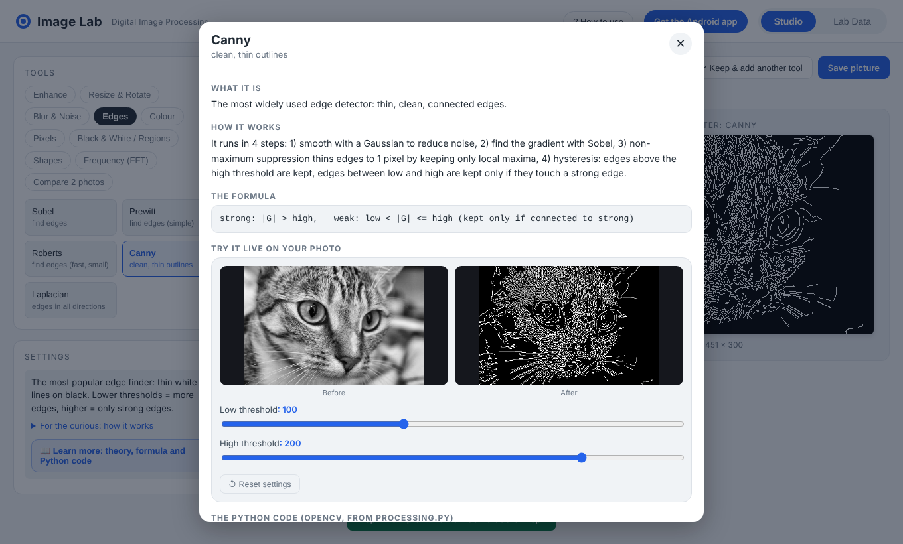
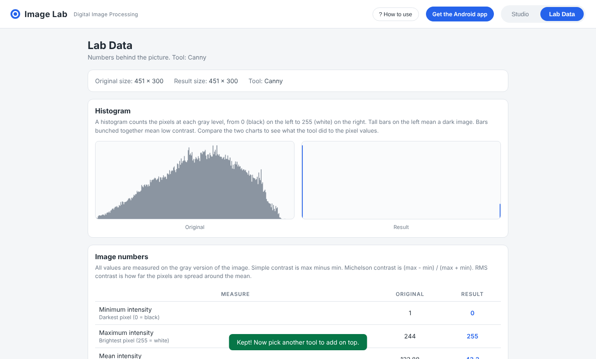

<div align="center">

# Image Lab

**Learn digital image processing by playing with your own photos.**

35 OpenCV tools, each explained in plain words, with the theory, the formula and the real Python code,
running live on your picture. Available as a website, an Android app and a Python/Flask app, all with the same interface.

[**Try the website**](https://digitalimageprocessingapp.netlify.app) ·
[**Download the Android app**](https://github.com/kashan-zahra/Project_dip/releases/latest) ·
[How it works](#how-it-works) ·
[Run it yourself](#run-it-yourself)



</div>

---

## Why I built it

In my Digital Image Processing lab every algorithm was a separate Python script: change a number,
run it again, open the output. Image Lab puts all of them in one place, so you can **see** what
an algorithm does while you move a slider, and then read **why** it does that.

It started as a Flask app for the lab, then I turned the same algorithms into a website that
runs entirely in the browser and an Android app that works offline. All three versions now share
one interface; only the engine underneath changes.

## Features

- **35 image-processing tools** in 10 groups: enhancement, transforms, filters, edge detection,
  colour spaces, sampling and quantization, segmentation, morphology, the Fourier transform and image comparison.
- **Live before / after:** split view on the website, a drag-to-compare slider in the app.
- **Learn more** for every tool: what it is, how it works, the formula, the exact Python/OpenCV
  code from the lab (with a copy button), real-world uses, and the tool working live on your photo while you read.
- **Beginner friendly:** simple names next to the technical ones ("CLAHE · smart local contrast"),
  a first-time guide with a flowchart, and "next step" hints.
- **Stack effects:** keep an effect and add another tool on top, see the steps
  (Original → Gamma → Canny), undo or jump back to any step, and compare with the last step or the original.
- **Lab Data:** histograms and contrast measurements (min, max, mean, Michelson, RMS) for before and after.
- **Pixel inspector:** a magnifier that shows the real pixel values under your mouse or finger.
- **Private by design:** every photo is processed on your own device. Nothing is uploaded.
- **Android app:** gallery and camera, save to the phone's gallery, works offline.

<div align="center">

<br><sub>Android app: start screen → pick a group → adjust one tool → Learn more</sub>
</div>

<div align="center">

<br><sub>The Python/Flask version: same interface, the processing runs in processing.py</sub>
</div>

<table>
<tr>
<td></td>
<td></td>
</tr>
<tr>
<td align="center"><sub>Learn more: theory, formula, live preview and the Python code</sub></td>
<td align="center"><sub>Lab Data: histograms and contrast measurements</sub></td>
</tr>
</table>

## The tools

| Group | Tools |
|---|---|
| Enhance | Brightness / Contrast, Gamma Correction, Negative, Contrast Stretching, Histogram Equalization, CLAHE, Log Transform, Bit-plane Slicing |
| Resize & Rotate | Crop, Resize (nearest / bilinear / bicubic), Rotate, Flip |
| Blur & Noise | Mean, Gaussian, Median and Bilateral filters, Add Gaussian Noise |
| Edges | Sobel, Prewitt, Roberts, Canny, Laplacian |
| Colour | HSI Components, RGB → HSI → RGB check, Color Spaces (HSV, LAB, YCrCb, Gray), RGB Channels |
| Pixels | Sampling, Quantization, Pixel Connectivity (4 / 8-connected components) |
| Black & White / Regions | Thresholding (Global, Otsu, Adaptive mean / Gaussian), K-Means |
| Shapes | Erosion, Dilation, Opening, Closing |
| Frequency (FFT) | Spectrum, Low-pass, High-pass |
| Compare 2 photos | Histogram Matching, Pixel Similarity |

## How it works

```
                         web/  (one shared interface: index.html, css/, js/)
                                         │
                                 js/engine.js picks the engine
                    ┌────────────────────┴─────────────────────┐
             Browser engine                               Python engine
   web/js/processing.js (OpenCV.js, WebAssembly)   python-flask/app.py + processing.py (OpenCV)
                    │                                          │
        ├──► website (Netlify, runs in the browser)    └──► Flask version: every image is
        └──► Android app (WebView, works offline)          sent to /process and handled in Python
```

- **One interface, three versions.** The website, the Android app and the Flask app all use the same
  `web/` folder. The Android project points its assets at it, and Flask serves it and tells it to use
  the Python engine (`window.IMAGE_LAB_SERVER`). A change to the interface updates all three.
- **Two engines behind one small API.** [`js/engine.js`](web/js/engine.js) gives the page the same
  functions (open, process, keep, copy) whether the pixels are processed by OpenCV.js in the browser
  or by `processing.py` on the Python server.
- **No server needed.** The Flask version sends every image to Python. The web version runs
  OpenCV compiled to WebAssembly, so it can be hosted for free as static files and works offline in the app.
- **Same results as Python.** [`tests/`](tests/) runs 47 tool settings through both versions and compares
  every pixel: 44 match within 1 gray level, and the 3 differences are explained there.
- **Learn more pages are generated** from `processing.py` by [`scripts/build_learn_data.py`](scripts/build_learn_data.py),
  so the code shown in the app is always the code the lab version runs.
- **Phone-friendly Android layout.** Inside the app the same page switches to an app layout
  (`css/app.css`, `js/app-layout.js`): a start screen, a top bar and a bottom dock that shows one thing at a time.

## Project structure

```
python-flask/        the Python version (Flask + OpenCV)
  app.py             serves the shared web/ interface, /process runs the tools in Python
  processing.py      all the image-processing functions (the original lab code)
  templates/         the original lab page, still at /classic
web/                 website + the Android app's content
  index.html
  css/style.css      website styles
  css/app.css        Android app layout
  js/engine.js       the two image engines: browser (OpenCV.js) and Python (Flask)
  js/processing.js   the algorithms (OpenCV.js port of processing.py)
  js/tools.js        tool list, simple names and help text
  js/studio.js       opening images, running tools, history, Lab Data, pixel inspector
  js/help.js         Learn more page and the How to use guide
  js/app-layout.js   Android layout: start screen, top bar, bottom dock
  js/learn-data.js   generated Learn more content
  vendor/opencv.js   OpenCV.js (WebAssembly)
  samples/           free sample photos
android/             Android Studio project (Java, WebView)
scripts/             builds learn-data.js from processing.py
tests/               Python vs JavaScript parity test
docs/screenshots/
```

## Run it yourself

**Easiest on Windows (with VS Code)**

1. Double-click **`setup.bat`** once. It creates the Python virtual environment in `venv/` and installs
   everything from `python-flask/requirements.txt`.
2. Open the project folder in VS Code (*File → Open Folder*). It uses the `venv` automatically.
3. Press **F5** and pick *Image Lab: Flask (Python engine)* or *Image Lab: Website (browser engine)*.
   Or just double-click `run-flask.bat` / `run-website.bat`.

**Python / Flask (the image processing runs in Python)**

```bash
cd python-flask
pip install -r requirements.txt
python app.py              # then open http://127.0.0.1:5000
```

It has every feature of the website, with the header saying "running on Python". The original
lab page is still available at http://127.0.0.1:5000/classic.

**Website**

```bash
cd web
python -m http.server 8000 # then open http://localhost:8000
```

Opening `index.html` directly from disk does not work, because OpenCV.js has to be loaded from a server.
Add `?app=1` to the address to preview the Android layout in a browser.

**Android app**

1. Open the `android` folder in Android Studio and let Gradle sync.
2. Press Run with a phone (USB debugging on) or an emulator.
3. For a shareable APK: *Build → Generate Signed App Bundle or APK → APK*.

Requires Android 7.0 (API 24) or newer.

**Deploy the website** for free on Netlify: connect this repository (the included `netlify.toml`
publishes the `web` folder), or drag the `web` folder onto [app.netlify.com/drop](https://app.netlify.com/drop).

## Built with

- [OpenCV](https://opencv.org/) for Python and [OpenCV.js](https://docs.opencv.org/4.x/d5/d10/tutorial_js_root.html) (WebAssembly)
- NumPy, scikit-image, Flask
- Plain HTML, CSS and JavaScript (no framework)
- Android WebView, `androidx.webkit` (Java)

## Credits

- Sample photos "Chelsea the cat" (Stefan van der Walt) and "Coffee" (Rachel Michetti), both CC0, from
  [scikit-image](https://scikit-image.org/docs/stable/api/skimage.data.html).
- OpenCV.js build from the [`@techstark/opencv-js`](https://www.npmjs.com/package/@techstark/opencv-js) package (Apache 2.0).

## About

Made by **Kazi Sharmin** ([@kashan-zahra](https://github.com/kashan-zahra)), Computer Science and
Engineering, Bangladesh Army University of Science and Technology (BAUST), Saidpur, as a Digital
Image Processing lab project.

Licensed under the [MIT License](LICENSE).
